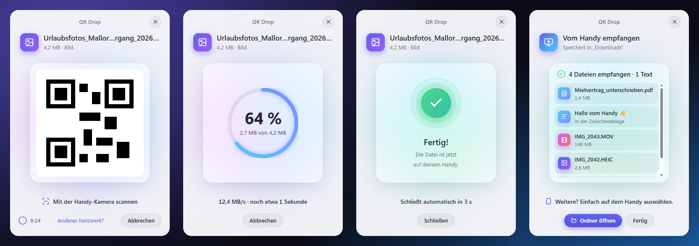

# QR Drop

[](https://github.com/peter-stuhlmann/QR-Drop/actions/workflows/ci.yml)
[](https://github.com/peter-stuhlmann/QR-Drop/releases/latest)
[](LICENSE)

**Rechtsklick auf eine Datei → „Per QR-Code senden“ → mit der Handy-Kamera scannen → fertig.**

QR Drop schickt Dateien vom Computer aufs Handy und zurück – ohne App auf dem Handy, ohne Cloud, ohne Konto. Computer und Handy müssen nur im selben WLAN sein. Für Windows 10/11 und macOS 12+, iPhone und Android.

<picture>
  <source media="(prefers-color-scheme: dark)" srcset="docs/screenshots/windows-dark.png">
  
</picture>

_[English below.](#english)_

## Herunterladen

Die aktuelle Version gibt es unter **[Releases](https://github.com/peter-stuhlmann/QR-Drop/releases/latest)**:

- **Windows 10/11:** die Datei, die auf **`x64-setup.exe`** endet
- **macOS 12+** (Apple Silicon und Intel): die Datei, die auf **`.dmg`** endet

Auf dem Handy wird nichts installiert.

## So geht’s

1. **Installieren**
   - **Windows:** Setup-Datei doppelklicken. Installiert wird nur für dich (kein Admin-Konto nötig). Einmal fragt Windows, ob QR Drop im privaten Netzwerk erreichbar sein darf – bitte mit „Ja“ bestätigen.
   - **macOS:** `.dmg` öffnen, QR Drop in „Programme“ ziehen, einmal starten. Das Willkommensfenster zeigt, wo der neue Eintrag zu finden ist.
2. **Senden:** Rechtsklick auf eine Datei, mehrere Dateien oder einen Ordner →
   - Windows 10: **Per QR-Code senden**
   - Windows 11: **Weitere Optionen anzeigen → Per QR-Code senden**
   - macOS: **Schnelle Aktionen → Per QR-Code senden**
3. **Scannen:** Kamera-App aufs Fenster halten, Link öffnen, **Herunterladen** tippen.

Ordner und Mehrfachauswahl kommen als ZIP an. Jeder Code gilt 10 Minuten und für genau einen Download; ein laufender Download wird beim Ablauf nicht abgebrochen.

Ohne Rechtsklick: QR Drop direkt starten und eine Datei ins Fenster ziehen oder „Datei auswählen …“ klicken.

### Texte, Links und Passwörter

Text kopieren, dann:

- **Windows:** Startmenü → **QR Drop - Zwischenablage senden** (lässt sich an die Taskleiste anheften).
- **macOS:** Text markieren → Rechtsklick → **Dienste → Text per QR-Code senden**.
- **Überall:** QR Drop öffnen und **Strg+V** bzw. **⌘V** drücken oder auf „Zwischenablage senden“ klicken.

Was dann passiert:

- **Links** stecken direkt im QR-Code – Scannen öffnet die Seite, ganz ohne WLAN-Verbindung zum Computer.
- **Texte** erscheinen auf dem Handy mit einem „Kopieren“-Knopf.
- **Passwörter** (erkannt an gemischten Zeichen ohne Leerzeichen) werden im Fenster nie angezeigt, auf dem Handy erst nach Tippen auf „Anzeigen“. Der Code gilt nur 2 Minuten und genau einmal.

### Vom Handy auf den Computer

1. QR Drop öffnen und auf **Vom Handy empfangen** klicken (Windows auch: Startmenü → **QR Drop - Vom Handy empfangen**, macOS auch: App-Menü → **Dienste → Vom Handy empfangen**).
2. Den QR-Code mit der Handy-Kamera scannen.
3. Auf dem Handy **Dateien auswählen** tippen – Fotos, Videos, Dokumente, auch mehrere auf einmal. Oder unten einen Text einfügen und **Zum Computer kopieren** tippen.

Dateien landen im Ordner **„Downloads“**, Texte in der Zwischenablage des Computers. Mit **Ordner öffnen** siehst du alles, was angekommen ist. Bricht die Verbindung ab (Handy gesperrt, WLAN weg), geht es danach an derselben Stelle weiter.

### Hilfe

| Problem                                                                       | Lösung                                                                                                                                                                           |
| ----------------------------------------------------------------------------- | -------------------------------------------------------------------------------------------------------------------------------------------------------------------------------- |
| Windows meldet beim Installieren „Der Computer wurde durch Windows geschützt“ | Auf **Weitere Informationen → Trotzdem ausführen** klicken. Die Meldung erscheint, solange der Installer nicht mit einem gekauften Zertifikat signiert ist.                      |
| macOS meldet „QR Drop kann nicht geöffnet werden“                             | **Systemeinstellungen → Datenschutz & Sicherheit**, nach unten scrollen, **Dennoch öffnen** klicken (bis macOS 14 auch: Rechtsklick auf die App → **Öffnen**). Nur einmal nötig. |
| Der QR-Code öffnet nichts                                                     | Handy und Computer müssen im **selben WLAN** sein. Gäste-WLANs trennen Geräte oft.                                                                                               |
| Die Seite lädt nicht                                                          | QR Drop in der Firewall erlauben (Windows: „Private Netzwerke“, macOS: „Eingehende Verbindungen erlauben“). Mehrere Netzwerke? Unter dem QR-Code „Anderes Netzwerk?“ wählen.     |
| Wo ist die Datei auf dem Handy?                                               | iPhone: App „Dateien“ → Downloads. Android: Benachrichtigungen oder App „Dateien“ → Downloads.                                                                                   |
| Der Eintrag im Rechtsklick-Menü fehlt                                         | QR Drop einmal direkt starten – die App richtet ihn wieder ein. Bis dahin funktioniert das Hineinziehen ins Fenster.                                                             |

### Datenschutz und Sicherheit

- **Nichts verlässt dein WLAN.** Dateien gehen direkt vom Computer zum Handy; es gibt keinen Server im Internet, kein Konto und keine Statistik.
- **Nur Geräte im eigenen Netz** werden bedient. Jeder QR-Code enthält einen zufälligen Schlüssel, gilt nur kurz und nur für diese eine Übertragung. Ein Verzeichnis des Computers ist nie einsehbar.
- **Empfangene Dateien** werden nie überschrieben und von Windows bzw. macOS wie Downloads aus dem Internet behandelt (Virenschutz, Warnung beim Öffnen von Programmen).
- **Einzige Internet-Anfrage:** Beim Öffnen des QR-Drop-Fensters (ohne Datei) fragt die App bei GitHub nach einer neuen Version. Installiert wird nur nach deinem Klick, und jedes Update ist digital signiert. Ohne Internet funktioniert alles andere unverändert.

---

## English

**Right-click a file → “Send via QR code” → scan with your phone camera → done.** No app on the phone, no cloud, no account – just the same Wi-Fi. For Windows 10/11 and macOS 12+, iPhone and Android.

**Download** the latest version from **[Releases](https://github.com/peter-stuhlmann/QR-Drop/releases/latest)**: the file ending in `x64-setup.exe` for Windows, the `.dmg` for macOS.

- **Windows:** run the installer (per user, no admin account needed; Windows asks once to allow QR Drop in private networks). Right-click → _Send via QR code_ (Windows 11: _Show more options_ first).
- **macOS:** drag QR Drop to Applications and open it once; right-click → _Quick Actions_ → _Send via QR code_. The menu entries follow the system language.
- **First start:** while the installers are not signed with a paid certificate, Windows may say “Windows protected your PC” → _More info_ → _Run anyway_; macOS may refuse to open the app → _System Settings → Privacy & Security_ → _Open Anyway_.

Folders and multiple files are sent as ZIP. Every code is valid for 10 minutes and one download; a running download is not cut off at expiry.

**From your phone to the computer:** open QR Drop → _Receive from phone_ (Windows also: Start menu → _QR Drop - Receive from phone_; macOS also: app menu → _Services_ → _Receive from phone_), scan the code and tap _Choose files_ on your phone – or paste a text and tap _Copy to computer_. Files are saved to “Downloads”, texts go to the clipboard. Interrupted uploads resume where they stopped.

**Text, links and passwords:** copy them, then use Start menu → _QR Drop - Send clipboard_ (Windows), select text → right-click → _Services_ → _Send text via QR code_ (macOS), or press Ctrl+V / ⌘V in the QR Drop window. Links go straight into the QR code; passwords stay hidden and expire after 2 minutes.

**Privacy:** files never leave your Wi-Fi, only devices in your local network are served, and every code is random, short-lived and single-use. The only internet request is the update check on GitHub when the main window opens; updates are signed and only installed when you click.

---

## Entwicklung

Voraussetzungen: Rust (stable, mindestens 1.83), Node.js LTS, pnpm 10 (`corepack enable`), unter Windows die Visual-Studio-Build-Tools. Den macOS-Teil baut und prüft die CI.

```bash
pnpm install
pnpm tauri dev                 # App mit Hot Reload (öffnet die Drop-Zone)
pnpm dev                       # nur UI im Browser, alle Zustände unter http://localhost:1420/?demo=1
pnpm test                      # Vitest (Zustandsautomaten, Formatierung)
pnpm lint && pnpm typecheck && pnpm format:check   # ESLint inkl. Barrierefreiheit (jsx-a11y), TypeScript, Prettier
cd src-tauri && cargo test     # Rust-Unit- und Integrationstests
cargo test --release -- --ignored huge_file        # > 4 GB Streaming-Test (langsam)
pnpm tauri build               # Installer (NSIS bzw. .dmg)
```

Eine Datei zum Testen direkt übergeben: `src-tauri/target/debug/qr-drop.exe "C:\pfad\datei.jpg"` (Debug-Builds loggen die Share-URL). Die verbindliche Projektbeschreibung mit allen Entscheidungen steht in [CLAUDE.md](CLAUDE.md).

### Aufbau

| Pfad                              | Inhalt                                                                                                   |
| --------------------------------- | -------------------------------------------------------------------------------------------------------- |
| `src-tauri/src/server/`           | HTTP-Server: Landingpage, Download mit Range, ZIP-Streaming, Vorschau, Empfang vom Handy                 |
| `src-tauri/src/share/`            | Freigaben, Token (128 Bit), Ablauf, Einmal-Download, Texte                                               |
| `src-tauri/src/app_core.rs`       | App-Kern: Freigaben, Fenster und Ereignisse ans Frontend                                                 |
| `src-tauri/src/net.rs`            | Auswahl der richtigen LAN-IP                                                                             |
| `src-tauri/src/args.rs`           | Pfade sammeln (300 ms Debounce für Mehrfachauswahl)                                                      |
| `src-tauri/src/update.rs`         | Auto-Updates über GitHub-Releases                                                                        |
| `src-tauri/src/integration/`      | Kontextmenü-Reparatur (Windows), Schnelle Aktionen und Dienste (macOS)                                   |
| `src-tauri/windows/hooks.nsh`     | Installer: Registry + Firewall-Regel                                                                     |
| `src/`                            | React-UI (Glas-Fenster, Zustandsautomat, Animationen)                                                    |
| `landing/index.html`              | Handy-Seite zum Herunterladen (Datei, ZIP oder Text)                                                     |
| `landing/upload.html`             | Handy-Seite zum Senden an den Computer                                                                   |
| `landing/common.css`, `common.js` | Gemeinsamer Teil beider Handy-Seiten; der Server setzt ihn ein, jede Seite bleibt eine Datei unter 30 KB |

### Release

Version nur in `package.json` pflegen, dann taggen: `git tag v1.0.0 && git push --tags`. GitHub Actions baut `.dmg` (Universal) und `-setup.exe` als Release-Entwurf mit automatisch erzeugten Release Notes. Die CI baut die Installer außerdem bei jedem Push auf `main` und einmal pro Woche, damit Installer-Fehler vor dem Tag auffallen.

Code-Signierung ist optional – ohne Secrets entstehen unsignierte Installer:

- **macOS:** Secrets `APPLE_CERTIFICATE`, `APPLE_CERTIFICATE_PASSWORD`, `APPLE_SIGNING_IDENTITY` (Signatur) sowie `APPLE_ID`, `APPLE_PASSWORD`, `APPLE_TEAM_ID` (Notarisierung). Der Release-Workflow reicht sie durch, sobald sie gesetzt sind.
- **Windows** (noch nicht im Workflow verdrahtet): entweder ein Code-Signing-Zertifikat (`.pfx` als Base64-Secret, im Workflow importieren und `bundle.windows.certificateThumbprint` setzen) oder Azure Trusted Signing (Secrets `AZURE_CLIENT_ID`, `AZURE_CLIENT_SECRET`, `AZURE_TENANT_ID` und `bundle.windows.signCommand`, siehe Tauri-Doku „Windows Code Signing“).

### Auto-Updates

QR Drop fragt beim Öffnen der Drop-Zone still unter `https://github.com/peter-stuhlmann/QR-Drop/releases/latest/download/latest.json` nach einer neuen Version (`plugins.updater.endpoints` in `src-tauri/tauri.conf.json`) und zeigt dann unten „Neue Version … – jetzt aktualisieren“. Installiert wird nur nach dem Klick und nie während einer Übertragung; jedes Update ist signiert und wird vor der Installation geprüft.

Einmalig vor dem ersten Release:

1. **Privaten Schlüssel sichern:** `~/.tauri/qr-drop.key` (ohne Passwort; unter Windows im Benutzerordner). Ohne ihn lassen sich installierten Versionen nie wieder Updates liefern – an einem sicheren Ort aufbewahren, niemals ins Repo.
2. **GitHub-Secret** `TAURI_SIGNING_PRIVATE_KEY` mit dem Inhalt dieser Datei anlegen (`TAURI_SIGNING_PRIVATE_KEY_PASSWORD` leer lassen). Nur dann baut der Release-Workflow die Update-Dateien und `latest.json`.
3. Den Release-Entwurf auf GitHub **veröffentlichen** – erst dann ist er unter `releases/latest` für die Apps sichtbar.

Lokal testen (nur Debug-Builds): `QRDROP_UPDATE_URL=<url zu latest.json>` zeigt auf einen eigenen Server, `QRDROP_UPDATE_DRY_RUN=1` lädt und prüft das Update, ohne es zu installieren.

## Lizenz

[MIT](LICENSE) © 2026 Peter R. Stuhlmann
